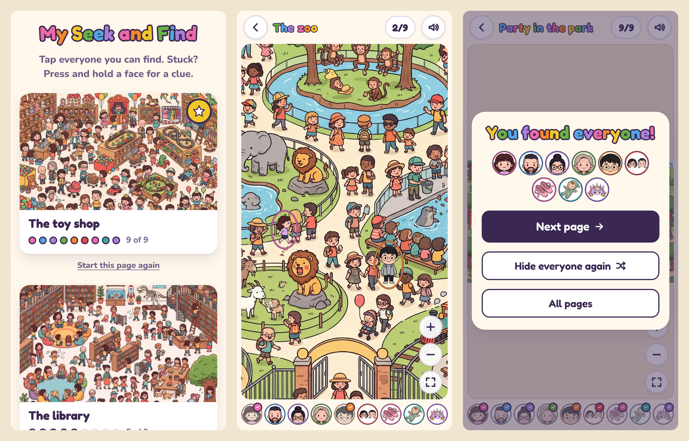

# Seek and Find

A seek-and-find game I made for my daughter, starring her own family as cartoons. Every busy picture hides the same nine: a girl, Dad, Mum, Grandma, an uncle, the grandparents, a pair of ballet shoes, a sleepy doll and the unicorn from the Monster Book. Tap everyone you can find.

**Try it:** [seek.mikeohalloran.au](https://seek.mikeohalloran.au/), or start at [the playroom](https://play.mikeohalloran.au/), the front door to all three labs: Monster Lab, Learning Lab and Seek Lab (this one).

Built with [Claude](https://claude.ai). It was planned as a printed book; the website is what it became. It's the sister project of [monster-book](https://github.com/mikeohallo/monster-book).



## The story

After the [Monster Book](https://monsters.mikeohalloran.au/), my daughter was getting a second book: a seek-and-find where the people hiding in the crowd are her own family, drawn as the cartoon versions she already knows from her stickers. It was planned as ten busy places, each across a two-page spread, coil-bound so it lies flat: a toy shop, a library, a playground, a supermarket, a swimming pool, an airport, Grandma's garden, a ballet school, a zoo and a party in the park. All ten are on the website, plus twenty-two more made just for the website: a whole street out trick-or-treating for Halloween, everyone in costume, four real places in Korea (the sunrise at Homigot in Pohang, with its giant bronze hands, Pohang's Jukdo Market, and Expo Science Park and the Sungsimdang bakery in Daejeon) four in Sydney (Circular Quay between the Harbour Bridge and the Opera House, Hyde Park, Town Hall and Bondi Beach), five more around Asia: Victoria Harbour in Hong Kong, Gardens by the Bay and the Lau Pa Sat hawker centre in Singapore, and KLCC Park under the Petronas Towers and the old streets of George Town in Malaysia, and five palace pages in Seoul long ago, where the whole family wears hanbok: Seollal, the Lunar New Year, in the courtyards of Gyeongbokgung Palace, the King's procession setting out through the palace gate, the changing of the guard at Gwanghwamun, a summer banquet at Gyeonghoeru on its lotus pond, and an autumn day in the Secret Garden of Changdeokgung, and three in Korea today: a picnic by the Han River under the Banpo Bridge rainbow fountain, the mountain-trout ice-fishing festival at Hwacheon, and a primary school sports day, red team against white. The printed copy is shelved: she took to the website and finished all ten pages, so the website became the game. She already does serious Where's Wally-style books, so the pictures are dense and mostly get harder as you go: about a hundred people on the first page, over 250 on the busiest, with the family the same size as everyone else.

The website is the same book on a phone. Same pictures, same family, same hiding places, plus things paper can't do: it knows when you've found someone, it can give a clue, and it remembers how far you got.

1. **Pick a page.** Each page shows who you've already found as coloured dots, and a star once everyone's found.
2. **Look.** Drag to move around and pinch to zoom on a phone; drag and scroll-wheel on a laptop. A phone held upright fills the screen with the picture and you pan sideways, like holding the book close.
3. **Tap.** Find someone and they get a ring in their colour, a chime, some confetti and a tick on their face in the row along the bottom. Tap nothing and you just get a little wobble, no buzzer.
4. **Stuck?** Press and hold a face, and a soft glow lights up roughly where they are. It's deliberately off-centre, so it narrows the search without giving the answer away.
5. **Everyone found.** A celebration, then on to the next page, or **Hide everyone again**: the family scatter to new hiding places on the same picture, in new poses, so a page you know by heart is a new game. Coming back to a page you've already finished does the same straight away, and its star stays on the home screen. Each new round on a page gets harder: from the third round, **lookalikes** join the crowd (a girl with the same hair in a yellow T-shirt, a bearded man in Dad's navy shirt with no tattoo, a pony with no horn), and some of the family sit down or hide behind something, a bush, a potted plant, a stack of boxes, peeking over the top. Tap a lookalike and it says "Nearly! That's not Dad." "Start this page again" on the home screen puts everyone back where the book has them, at the easy level.

A gift link like `?for=Max` makes it "Max's Seek and Find" on that device.

## How it's built

**The book and the website come from the same file.** That's the main design decision.

The pictures are painted by Google AI Studio, but AI image models can't be trusted with a seek-and-find. Asked to hide the girl once, the first test drew her five times, gave Dad's tattoo to a stranger and invented a second Grandma. So the scenes are painted with no family in them at all, and the family are added afterwards in code, as cut-outs, at positions written down in one file (`scenes.json`). From that one file:

- the print pages are built (A4, 300 ppi, each spread split across two pages with the coil gap allowed for);
- the answers pages at the back of the book are drawn;
- the website's data is exported: each find's box as fractions of the picture.

So the answer key is right by construction, and the website and the book always agree.

The website goes one step further: it gets the pictures *empty*, plus the family cut-outs, and places everyone itself. A first play uses the book's places. **Hide everyone again** picks a new mix from a list of checked spots on each page (about 30 per page, over 700 in all: feet on open ground, nobody in front, each one looked at zoomed in), with room for the grandparents' pair and smaller spots for the toys. A round is just a random seed (and its level) saved on the device, so a half-finished round comes back the same after a reload. Harder rounds use the same spots: the lookalikes take the spots nobody is using, and a hiding find is drawn with a prop in front, picked to suit the page and the spot (suitcases at the airport, presents at the party, a bush only where the ground is grass).

The site itself follows the monster site: **one HTML file plus pictures.** No framework, no server, no accounts, no analytics, hosted free on Cloudflare Pages. Progress lives in `localStorage` on the device. The chime is synthesised with Web Audio, so there are no sound files. Nothing anyone does in the game leaves their phone; the only outside request is Google Fonts. The one exception is a gift link, which carries the child's first name in its address (`?for=Max`): opening it, or following the "More to play" link at the bottom back to [the playroom](https://play.mikeohalloran.au/), sends that name to the site's hosting as part of the page request, and nothing else. The site asks search engines not to list it.

**English and Korean.** A switch on the home page turns the whole game into Korean and back, and the device remembers it. Every word the game shows lives in two files, `tools/lang/en.json` and `tools/lang/ko.json`, with the same keys in each, so a new page adds one line to each; the build stops, and a test fails, if either is missing a line. Korean puts a small word after a name that depends on how the name ends (아빠를 but 삼촌을, for "Dad" and "Uncle"), so the Korean lines mark the spot (`{name|을/를}`) and the page picks. The Korean font (Jua and Gowun Dodum from Google Fonts) loads only when Korean is on, cut down to the few hundred letters the game uses.

**The family's own names aren't public.** This repo and the public page only know generic labels: Girl, Dad, Mum, Grandma, Uncle, Grandparents. My daughter's devices show her own names for everyone, from a private link (`hide.py link` makes it from `scenes.json`, which isn't in the repo) that carries them after the `#` in the address. Browsers never send that part to the server; the page keeps the names on the device and takes them out of the address bar straight away.

### Things that turned out to matter

- **Density first.** The first mock had 40 people and was far too easy. A test prompt asking for "at least 150 tiny people" came back with about 160, all crisp at print size, so one image per spread is enough and the difficulty comes from the crowd, not tricks.
- **Show the whole place.** Asking for "a busy toy shop" or "a big library" gave big people and empty floor, however many people the prompt asked for. Asking for the whole place at once, like a map seen from high above (every aisle, every checkout, the bakery and the deli all in one picture), forced everything smaller. From the supermarket on, the pictures came back with more people at about two-thirds the size.
- **"Add more people" mostly doesn't work.** Sending a sparse picture back and asking AI Studio to keep everything and add 120 more people returned almost the same picture. Rewriting the prompt and starting again worked better. The palace was the exception: a repaint filled its empty throne courtyard but softened everything else a little, and since the repaint lined up with the original almost pixel for pixel, only the courtyard was blended in.
- **Real places need photos, and a high view.** For the Korea pages AI Studio got two or three photos of each place along with the style picture, so the Homigot hands, the Expo tower and bridge and the brick bakery look like themselves. The first Homigot and Jukdo pictures came back close up, with big people and room to spare; asking for the view "from a tall building or a drone", with every person no taller than about a twenty-fifth of the picture and at least 300 of them, brought the crowd back. The Sydney pages asked for that from the start, and Bondi and Circular Quay still needed a second go: "looking almost straight down, so the people along the bottom edge are just as tiny as the ones at the top" fixed the big people across the front, and "the sand is so crowded you can hardly see it" filled the beach. The palace banquet and garden went the same way: the first pictures drew the buildings big and only about a hundred people, and putting the pavilion small in the top third, with a festival ground below for 400 people, brought the crowd back.
- **Modern places needed counting, not just "300 people".** The first Han River, ice-fishing and sports day pictures all came back with about 150 people at twice the size. What brought the crowd back was counting things and pinning their size to the picture: more than 80 picnic mats, more than 300 fishing holes with someone at nearly every one, each hole no wider than a hundredth of the picture, and the festival "carries on past every edge, so there is no row of big people across the front". The sports day never came small, whatever the prompt said (not even when shown a finished page as the size to copy), so it's an easier page with fewer, bigger people, recoloured in code from blue-against-white to red-against-white so the crowd isn't in the family's colours.
- **Tiny people lying down come out half-made.** That packed Bondi looked fine from a distance, but up close a lot of the sunbathers were smudged, faceless or melting into their towels: the image model draws a tiny person standing far better than one lying flat. Asking for everyone to be standing, walking, sitting up or kneeling, and for every person to be complete and as crisp as the rest, fixed it, and every page since asks for that too. The photos for the real places aren't in the repo.
- **Words sneak in.** Every prompt says no text anywhere, and signs still came back saying ZOO, SNACK and ICE-CREAM. They're painted out in code, filled with the sign's own colour, before the family goes in, so every page stays wordless.
- **New rounds need hand-checked spots, not random ones.** Dropping the family anywhere on the floor looks wrong half the time: feet on a table, a head poking out of someone else's, a person half inside a shelf. `hide.py slots` suggests spots with the same open-floor test as the book and draws each one with a stand-in figure; only the ones that look right are kept. One spot was dropped because a fairy behind it made whoever stood there look like they had wings.
- **Size to the crowd at the same depth.** After every page had been played, the grown-ups looked a little big and the ballet shoes and unicorn a little small. Measuring showed why: the pictures have perspective, so people further up are smaller, but each find had one size for the whole page, and that size was set from one spot. Each page now lists a few crowd heights measured from top to bottom, and the website sizes everyone from the crowd where they stand, in the book's places and in new rounds. The toys are never smaller than before, and the shoes and unicorn are about a third bigger.
- **Lookalikes should differ in one clear way.** Each one shares nearly everything with a find and changes one or two things a small child can check: the hair, the glasses, the beard, the tattoo, the horn. AI Studio drew all 18 right first time when every prompt said what the figure does *not* have, and threw in a seventh couple.
- **Hide behind things you add, not things in the picture.** The plan was to hide people behind counters, hedges and walls already in the scenes, but half the pages (the playground, the pool, the airport) have almost none. A sheet of props in the same style (boxes, a plant, a bush, a crate, suitcases, presents), pasted in front of a figure at a checked spot, works on every page and needs no clipping.
- **A page can change the family's clothes.** In a palace crowd where everyone wears hanbok, the family in their everyday clothes would be found in seconds, so the palace pages dress them in hanbok too, each in their usual colours and with the same faces, hair and glasses. AI Studio drew the hanbok sheets on exactly the layout of the everyday ones (every pose within half a percent of its twin), so each costume cut-out takes its twin's size, and a page just names its costume (`co` in `scenes.json`): the website swaps in that costume's cut-outs, sitting and peeking poses, its own lookalikes (strangers in hanbok who share all but one thing with a find) and its own faces on the strip. The toys stay as they are.
- **Dad is still never mirrored in new rounds.** Everyone else may face either way.
- **Nobody stands in front of a find who shouldn't.** A pasted cut-out is always on top, so if a child in the crowd is nearer the viewer than the hidden Dad, Dad looks like he's standing on her head. `hide.py spots` suggests places where the floor just below the feet is open, so there's nobody in front. Flat roofs read as open floor too, so each scene can list no-go boxes.
- **Peeking needs a ledge.** Some cut-outs peek over a wall. AI Studio always draws the wall as a line, with fingers gripping over it. The cutter erases the line but keeps the fingers, finding the line from the columns that stick out past the figure on both sides.
- **Dad is never mirrored.** His tattoo is on one arm. Flip the cut-out and it's on the other, so the builder refuses a flipped Dad.
- **Fingers are bigger than hidden people.** A find on a phone can be a few millimetres tall. Taps count within a box 40% bigger than the find, and never smaller than a fingertip on screen.
- **A drag isn't a tap.** Moving more than a few pixels turns a touch into a pan, so looking around never counts as a guess.
- **Nothing to read.** The faces along the bottom are the to-do list. Found ones get a tick in their colour.
- **Progress belongs to a picture, not a page number.** When the toy shop replaced the test playground as page 1, a phone that had finished the playground showed the toy shop as already done. Each page now carries a key made from its picture and hiding places, so ticks from an old version never carry over, and picture links include a fingerprint so phones fetch a changed picture instead of a cached one. A rename isn't a change, though: when the family's names came out of the public files, each page kept its old key (`key_pin` in `scenes.json`, dropped as soon as the page really changes), so every star and round carried over.

## What's in this repo

| Path | What it is |
|---|---|
| `index.html` | The whole site: markup, styles and script in one file, as hosted |
| `tools/site_src.html` | The same page as written for the Claude preview, before `make_site.py` wraps it for hosting |
| `tools/hide.py` | The book builder: cuts figures out of AI Studio character sheets, suggests and checks hiding places, builds the print pages, the who's-hiding page, the answers and the PDF, finds and records the spots for new rounds (`slots`), exports the website's empty pictures, cut-outs and data, including the lookalikes, props and sitting and peeking poses for harder rounds and the costumes some pages dress the family in, and makes the private names link (`link`) |
| `tools/gen.py` | Makes the character sheets and scenes with Google AI Studio's image model (needs your own API key) |
| `tools/prompts.json` | The prompts for every character sheet and scene, the lookalike and prop sheets, and the hanbok sheets for the palace pages (the real-place scenes also attach reference photos of the real places, which aren't in the repo) |
| `tools/make_site.py` | Wraps the page for hosting (plain link says "My Seek and Find"), builds the English and Korean text and the Korean font link into it, and zips it for Cloudflare Pages |
| `tools/lang/en.json`, `tools/lang/ko.json` | Every word the game shows, one file per language: buttons and messages, what each find is called, and each page's title |
| `tools/check_lang.py` | Checks the two language files against each other and against the pages: no missing lines, no lost name slots |
| `tools/test_site.py` | Drives the site in Chromium at phone and laptop size: every find, a miss on an empty part of the picture, reload, the finale, start again, zoom, drag, clues, and a new round on every page (everyone moves, nobody overlaps, every find taps, a reload keeps the round), a finished page reopening as a new round with its star kept, harder rounds on every page (levels in turn, lookalikes and hiding, nothing overlapping, a lookalike tap says "Nearly!" and doesn't count), the private names link (own names shown, ticks carried over from a renamed find, the address bar cleaned, a broken link ignored), costumes (on a palace page everyone is in hanbok in every kind of round, with hanbok lookalikes and faces, and every other page unchanged), and languages (the switch turns every screen to Korean and back, is remembered, loads the Korean font only in Korean, and never touches a tick or a star); `--lang ko` runs it all again in Korean |
| `docs/` | Screenshot |

The pictures aren't in the repo; they're the book. Nor are `scenes.json` (where every hiding place lives, so it would give the answers away, and where the family's own names are kept) and the `website/` output folder, so `hide.py` and `make_site.py` won't run from a clean clone; `index.html` is the built result and is complete. The tools, prompts and tests are all here.

## Running it locally

The page needs to be served, not opened from a file:

```
python3 -m http.server 8000
```

Then open `http://localhost:8000`. Without `data.json` and the pictures you'll get the page frame with nothing to play, which is enough to see how it's put together.

## Credits

Pictures generated with Google AI Studio. Fonts: [Fredoka](https://fonts.google.com/specimen/Fredoka) and [Nunito](https://fonts.google.com/specimen/Nunito), both Open Font Licence. Site and tools written with Claude.

Made for my daughter.
